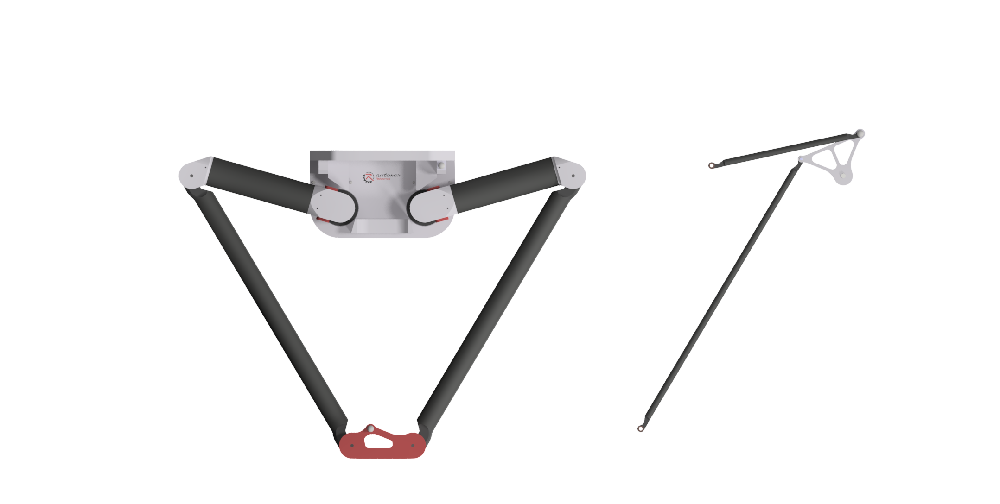

## Abstract

Die vorliegende Arbeit verfolgt das Ziel, ein Grey-Box-Modell für einen DuoPod-Roboter zu entwickeln. Dieses Modell umfasst drei Modellierungsansätze: die Simulink-Simulation unter Zuhilfenahme der Simscape-Bibliothek, die dynamische Modellierung der vereinfachten Roboterstruktur sowie die Implementierung eines neuronalen Netzwerks zur Fehlerkompensation. Die Abbildung 1 zeigt links das CAD-Modell des realen Roboters und rechts eine Abbildung des modellierten Roboters. Zu erkennen ist, dass in der Modellierung die Hilfskinematik vernachlässigt wird, wodurch das dynamische Modell des Roboters vereinfacht wird. Die Hilfskinematik hat den Zweck den Endeffektor jederzeit parallel zur Roboterbasis zu halten.

## Additional materials

Here comes additional information about the research.
Link zu vorhandenem Repo

## Figures

